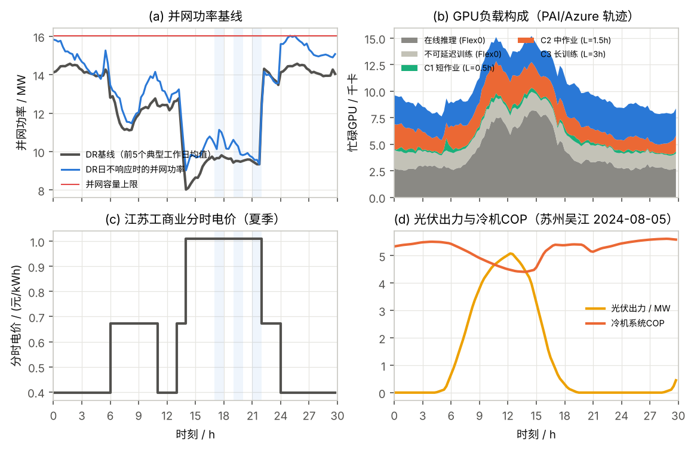
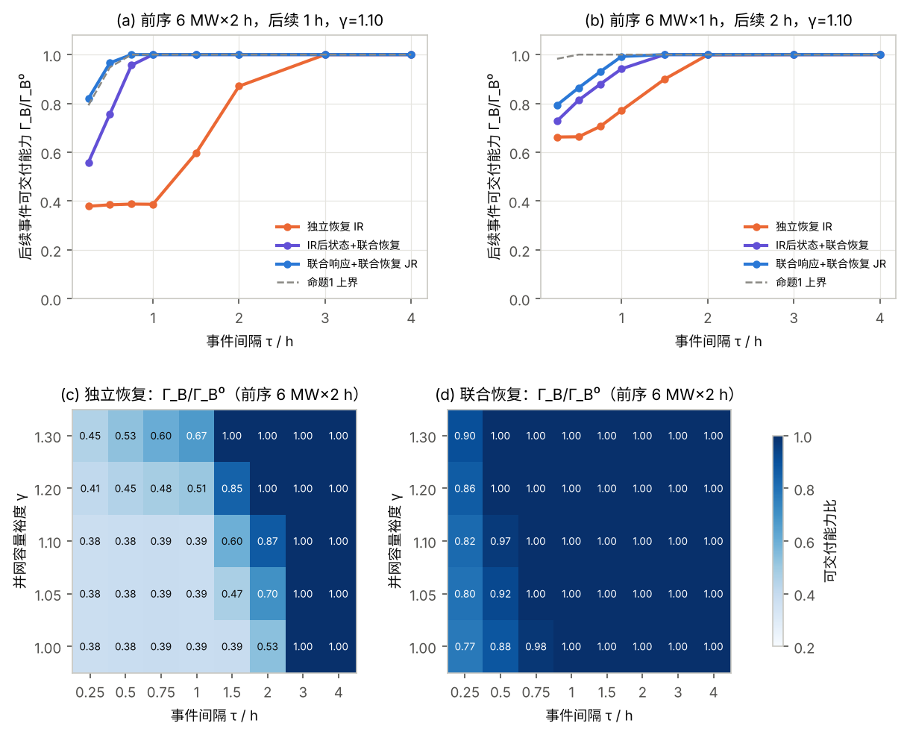
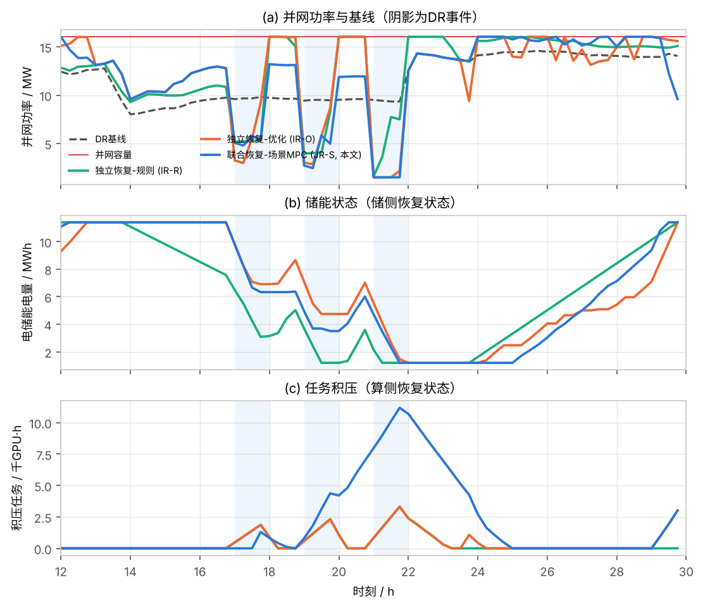
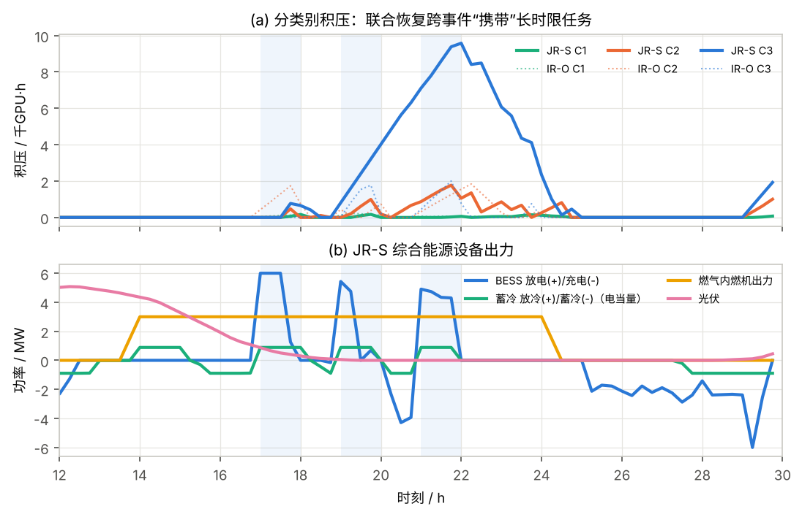
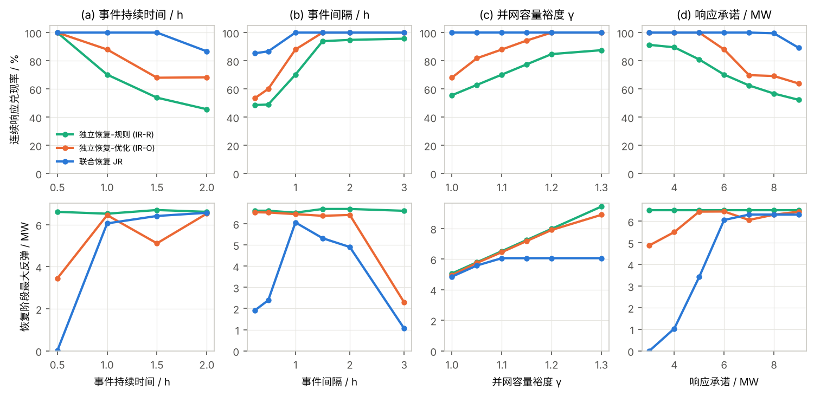
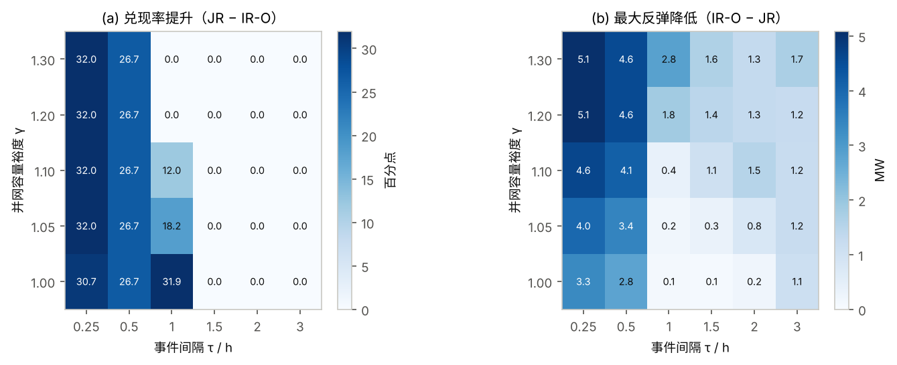
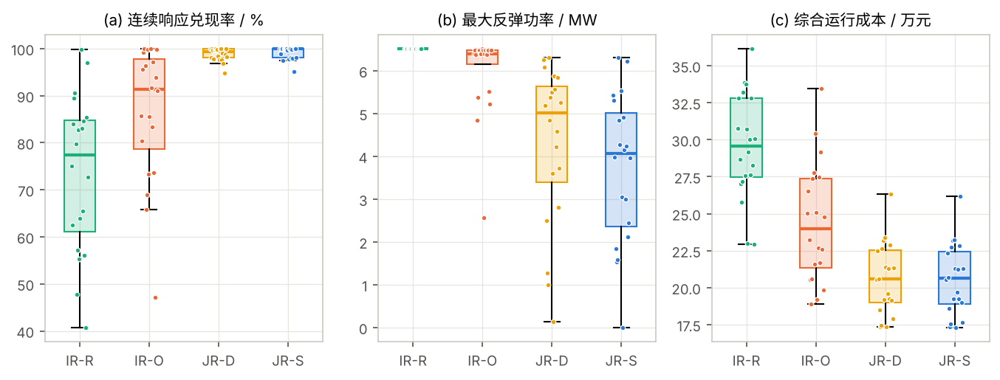
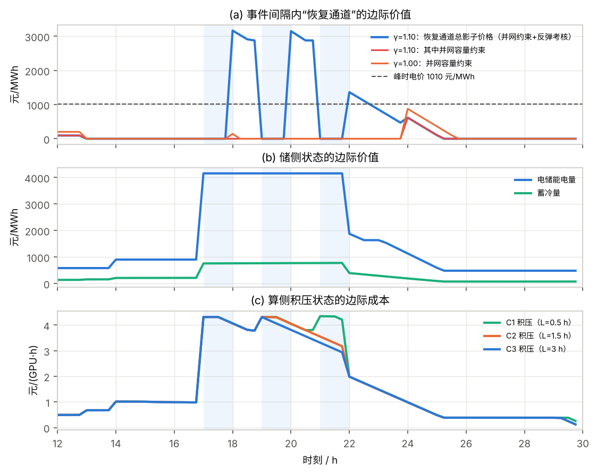
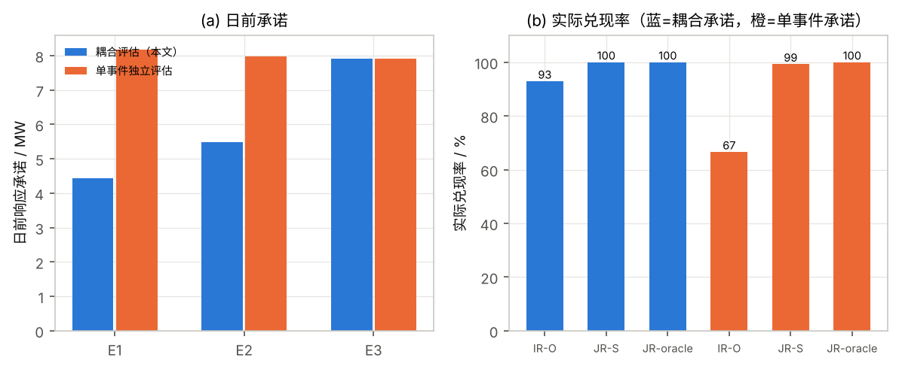

# 计及跨事件算储联合恢复的数据中心综合能源系统连续需求响应优化调度 —— 论文主要思路与可复现实验设计

> 本文档给出论文的完整故事线、模型、命题、方法、算例设计与仿真结果。所有数值结果均由仓库中 `matlab/main_run_all.m` 在公开数据上复现得到（GNU Octave 8.4 + glpk 实测；MATLAB `intlinprog`/Gurobi 同样可运行）。参数逐项标注来源：**[S]** 取自文献/政策原文，**[D]** 由公开数据推导，**[A]** 学术假设（均在敏感性分析中检验）。

---

## 摘要（已填入仿真数值）

**中文摘要：** 人工智能数据中心可通过计算任务延迟与储能调节参与需求响应，但上述调节行为会在响应后留下未完成任务与储能能量缺口。当多次响应间隔较短时，任务补算与储能回充共同占用有限的供电容量，使后续响应能力受到前序运行状态的影响。针对这一跨事件耦合问题，提出计及算储联合恢复的数据中心综合能源系统连续需求响应优化调度方法。首先，综合考虑任务到达、剩余工作量、完成时限及储能荷电状态，构建算储双状态恢复模型；将分级服务等级协议下的可延迟算力刻画为容量由完成时限决定的虚拟储能，结合共享并网容量与电—冷—热平衡约束，刻画任务补算、储能回充及后续响应能力之间的耦合关系，并给出后续响应可交付能力的解析上界。其次，建立日前响应承诺—日内滚动协同优化框架，在任务服务质量、有效响应判定与状态恢复约束下，联合优化计算任务执行、储能充放电及综合能源设备运行，并采用基于场景的模型预测控制处理任务到达、推理负荷与新能源出力的不确定性。基于阿里 PAI GPU 集群轨迹与 Azure 大模型推理轨迹设计多事件需求响应算例，分析响应持续时间、事件间隔及并网容量对调度性能的影响。结果表明：独立恢复须偿还全部双状态欠账方能恢复响应能力，事件间隔不超过 1 h 时后续响应可交付能力仅为单事件能力的 38%~39%，而联合恢复在相同事后状态下 0.75 h 内即可恢复至 96%；在相同响应承诺和任务服务要求下，与独立恢复策略相比，连续响应兑现率提高 12.7 个百分点，恢复阶段最大反弹功率降低 37.8%，系统综合运行成本降低 15.7%（20 个运行日均值，对比优化型独立恢复；对比规则型独立恢复分别为 25.5 个百分点、42.7% 和 30.5%）。

**English abstract:** AI data centers can provide demand response (DR) by deferring computing workloads and dispatching battery energy storage systems (BESS). However, these actions leave unfinished workloads and battery energy deficits after a response event. When DR events occur in close succession, workload catch-up and battery recharging compete for limited power-supply capacity, making subsequent response capability dependent on preceding operating states. This paper proposes a coordinated scheduling framework for AI data center integrated energy systems considering cross-event computing–storage recovery. First, a coupled recovery-state model is developed by incorporating task arrivals, remaining workloads, completion deadlines, and BESS state of charge, in which deferrable computing under tiered service-level agreements is represented as a virtual storage whose capacity is set by deadlines. Combined with shared grid connection limits and electricity–cooling–heat balances, the model captures the coupling among workload catch-up, battery recharging, and subsequent DR capability, and an analytical bound on the deliverable capability of a subsequent event is derived. Then, a day-ahead commitment and intraday rolling optimization framework is formulated to jointly schedule workload execution, BESS operation, and integrated energy equipment while satisfying task service requirements, DR validity rules and state recovery constraints. Scenario-based model predictive control is employed to accommodate uncertain workload arrivals, inference demand and renewable generation. Case studies built on the Alibaba PAI GPU cluster trace and the Azure LLM inference trace examine the effects of response duration, event intervals, and grid connection limits. Independent recovery must repay the entire dual-state deficit before capability returns, leaving only 38–39% of the single-event capability for a subsequent event within a 1-h interval, whereas joint recovery restores 96% within 0.75 h from the same post-event state. Under identical DR commitments and service requirements, compared with independent recovery, joint recovery increases the consecutive DR fulfillment rate by 12.7 percentage points and reduces the peak rebound power during recovery by 37.8% and the comprehensive operating cost by 15.7% (mean over 20 operating days, versus optimization-based independent recovery; 25.5 points, 42.7% and 30.5% versus rule-based independent recovery).


---

## 0 先回答两个核心研究问题

**问题一：在任务完成时限与并网容量共同约束下，前序响应留下的“双状态恢复需求”如何影响后续响应的可交付能力？**

1. 一次削峰响应结束时，数据中心同时留下两类“欠账”：**算侧**——被延迟的训练/批处理任务形成带截止时间的积压 $B_c$（等价于一块“虚拟储能”被放空，容量由时限决定）；**储侧**——电储能/蓄冷的能量缺口。二者的补偿都要通过同一条“恢复通道”：事件间隔内并网容量与基线负荷之间的余量 $H(\tau,\bar P)=\sum_{t\in(e_A,s_B)}(\bar P-P^{\rm b}_t)^+\Delta t$。
2. 后续事件的可交付能力受三类上限共同决定（命题1）：单事件能力 $\Gamma_B^0$；能量型上限（剩余储能 + 时限允许的新增积压 + 恢复通道能量 − 尚未补算的积压）；功率型上限（仍可暂停的算力功率 − 在下一事件内到期而未补完的积压 + 储能可放功率）。当间隔 $\tau$ 短或并网余量 $\gamma$ 小，能量型上限变为有效约束，可交付能力随 $\tau$、$\gamma$ 近似线性上升，直至达到 $\Gamma_B^0$；间隔与并网余量**相互替代**（等可交付能力曲线在 $\tau$–$\gamma$ 平面呈双曲型）。
3. 时限的作用是双向的：短时限任务（C1/C2）的积压**必须**在间隔内补算或在下一事件中被强制执行（直接侵蚀下一事件的削减量）；长时限任务（C3）的积压可以**跨事件携带**，把恢复推迟到最后一个事件之后。是否利用这一点，正是联合恢复与独立恢复的分水岭。
4. 定量结果（实验1，前序 6 MW×2 h、后续 1 h、γ=1.10）：事件 A 结束时留下 4.9 MWh 算侧积压与 12.3 MWh 储侧缺口。独立恢复下，间隔 ≤1 h 时后续事件只能交付单事件能力的 **38%–39%**，间隔 2 h 才回到 87%；在**完全相同的事后状态**下改用联合恢复，间隔 0.25/0.5/0.75 h 时分别回到 **56%/76%/96%**；若前序响应也联合规划，可达 **82%/97%/100%**。也就是说，独立恢复要“还清全部欠账”，联合恢复只需偿还“下一事件需要的那一部分”。

**问题二：联合恢复调度相较独立调度能带来多大改善？**

| 对比（相同承诺、相同 SLA） | 连续响应兑现率 | 恢复阶段最大反弹功率 | 系统综合运行成本 |
|---|---|---|---|
| 主算例（DR 日，日前协同承诺）：JR-S vs IR-O | **+7.09 个百分点**（100% vs 92.91%） | **−46.3%** | **−13.2%** |
| 主算例：JR-S vs IR-R | +26.36 个百分点 | −46.7% | −30.4% |
| 20 日蒙特卡洛均值：JR-S vs IR-O | **+12.72 个百分点**（99.1% vs 86.4%） | **−37.8%** | **−15.7%** |
| 20 日蒙特卡洛均值：JR-S vs IR-R | +25.51 个百分点 | −42.7% | −30.5% |

改善集中在“事件间隔短（≤1 h）、并网余量紧、事件持续长、承诺水平高”的区域；间隔 ≥1.5 h 或承诺很低时两者差别很小（第 6.3 节）。纯能量成本（购电+燃气+退化）仅降低 0.7%–1.8%，综合成本的下降主要来自兑现率提升带来的补贴增加与偏差、反弹考核的减少。

---

## 1 题目、关键词与研究定位

**题目：** 计及跨事件算储联合恢复的数据中心综合能源系统连续需求响应优化调度
（Coordinated Scheduling for Consecutive Demand Response in AI Data Center Integrated Energy Systems Considering Cross-Event Computing–Storage Recovery）

**关键词：** 人工智能数据中心；连续需求响应；任务积压；算储联合恢复；跨事件状态耦合；优化调度

### 1.1 背景（均为可核查的事实）

* **负荷规模。** IEA《Energy and AI》(2025)：2024 年全球数据中心用电约 415 TWh（约占 1.5%），2030 年将增至约 945 TWh，AI 是最主要驱动[1]。LBNL（2024.12）报告：美国数据中心 2023 年用电 176 TWh、占全国 4.4%，2028 年情景为 325–580 TWh（最高约 12%），增长主要来自 GPU 加速服务器[2]。我国《数据中心绿色低碳发展专项行动计划》(2024)要求 2025 年底平均 PUE 降至 1.5 以下、新建大型及超大型数据中心 PUE ≤1.25、国家枢纽节点 ≤1.2[3]。
* **并网约束成为瓶颈。** Duke 大学 Nicholas 研究所（Norris 等, 2025）测算：若大负荷每年可被削减 0.25%–1% 的时间，美国 22 个最大平衡区无需新增容量即可接入 76–126 GW 新负荷[6]——“柔性并网/非固定容量”正成为 AI 数据中心快速接网的现实路径；美国得州 SB 6 法案（2025）进一步要求 ≥75 MW 的大负荷在紧急时接受削减[26]。
* **需求响应政策与实践。** 《电力需求侧管理办法（2023 年版）》要求到 2025 年各省需求响应能力达到最大用电负荷的 3%–5%[4]。《江苏省电力需求响应实施细则》(2024)明确数据中心可参与需求响应；约定响应原则上每日不多于 2 次、累计不超过 2 h；有效响应判定为“响应时段平均负荷较基线下降 ≥80% 响应能力确认值、且最大负荷不高于基线最大负荷”，超过 120% 按 120% 计；削峰补贴最高限价 3 元/kWh，日内提前 2–4 h、0.5–2 h 通知的响应速度系数分别为 1.4、1.6；基线取前 5 个正常工作日平均负荷[5]。Google 2025 年与 I&M、TVA 签订以机器学习负载为对象的需求响应协议[8]；Emerald AI 在凤凰城 256 卡集群上实现 3 h 内功率降低 25% 且满足 QoS，并提出 Flex 0–3 分级（3–6 h 内允许平均吞吐下降 0/10%/25%/50%）[7]。
* **反弹问题。** 需求响应后的负荷反弹（payback/rebound）早有报道：偏远社区实证中事件后出现 30%–50% 的时移反弹峰[27]。

### 1.2 研究空白

| 已有研究 | 主要做法 | 与本文差异 |
|---|---|---|
| 数据中心 DR 经典工作[9-11] | 负荷时空迁移 + 本地发电，单次或日内峰值管理 | 未刻画事件之间的状态耦合 |
| 数据中心多层/多时间尺度 DR 调度[12]、IES 规划运行[14,15] | 冷热电多能互补、负载时空可调 | 储能与算力的“恢复”被视为各自子问题 |
| 碳感知/容量曲线[13] | 日内总量守恒的柔性计算 | 不涉及连续事件与并网容量下的恢复竞争 |
| 现场示范[7,8] | 单事件 3 h 削减 | 事件后补算与储能回充未优化 |

**本文要回答的新问题：** 当多次 DR 事件间隔很短时，**任务补算与储能回充共享有限的并网余量**，前序响应的“双状态欠账”如何决定后续响应能力？如何在日前承诺与日内调度中显式利用这一耦合？

### 1.3 主要贡献

1. **算储双状态恢复模型。** 用“滞后上界”刻画 Flex 分级 SLA，导出任务积压 $B_{c,t}$ 的时变上界 $\bar B_{c,t}$，把可延迟算力表述为“容量由时限决定、往返效率≈1”的虚拟储能，与电/冷储能共同构成恢复状态；结合并网容量与电–冷–热平衡刻画补算、回充与后续能力的耦合。
2. **跨事件可交付能力命题（命题1）与两条推论。** 给出后续事件可交付能力的解析上界、最小全恢复间隔及“间隔—并网余量替代关系”，并用影子价格解释恢复优先序。
3. **日前协同承诺—日内场景 MPC 框架。** 日前两阶段随机 MILP 以耦合恢复约束确定各事件承诺；日内滚动场景 MPC 联合优化任务执行、储能与 IES 设备，嵌入江苏有效性判定（80%/120%）、基线最大负荷、偏差与反弹考核。
4. **基于公开 GPU 轨迹的可复现算例。** 阿里 PAI GPU 集群轨迹 + Azure 2024 LLM 推理轨迹 + ERA5 气象 + 江苏 2025 分时电价与 2024 需求响应细则；对比规则型/优化型独立恢复，量化兑现率、反弹功率与成本改善，并给出持续时间、间隔、并网容量、承诺水平的敏感性与 20 日蒙特卡洛检验。

---

## 2 系统与问题描述

**AIDC-IES 结构：** 16 000 张 H100 级 GPU（2 000 台 8 卡 HGX 节点）；电–冷–热耦合：电网（容量 $\bar P$）、光伏 8 MWp、3 MW 燃气内燃机 + 余热吸收式制冷机、电制冷机组（COP 随气温变化）、10 MWh 冷水蓄冷罐、6 MW/12 MWh 电储能。

**负载分层（对应 Emerald AI Flex 分级）：**

| 类别 | 来源 | 可延迟性 | 滞后上界 $L_c$ |
|---|---|---|---|
| 在线推理（Flex 0） | Azure LLM 2024 轨迹形状 | 不可延迟 | 0 |
| 不可延迟训练（Flex 0） | PAI 轨迹 × 25% | 不可延迟 | 0 |
| C1 短作业（运行时长 ≤1 h） | PAI 轨迹 × 75% | Flex 1 | 0.5 h |
| C2 中作业（1–12 h） | 同上 | Flex 2 | 1.5 h |
| C3 长训练（>12 h） | 同上 | Flex 3 | 3 h |

$L_c$ 由 Flex 分级“6 h 窗口内平均吞吐下降 10%/25%/50%”换算（$L=\beta\times 6\,\text{h}$）[7]。

**连续 DR 时序（江苏规则）：** E1 17:00–18:00、E2 19:00–20:00 为日前约定响应（单价 3 元/kWh），E3 21:00–22:00 为快速避峰响应（日前预通知时段、日内提前 3 h 确认，速度系数 1.4，4.2 元/kWh）。事件间隔 1 h，恰为“恢复通道”最紧张的晚高峰时段（分时电价峰段 14–22 时）。

**恢复状态与“恢复通道”：** 事件结束时刻 $e_k$ 的状态 $\mathbf{x}_{e_k}=(B_{1},B_{2},B_{3},E,S)$；事件间隔 $(e_k,s_{k+1})$ 内可用于恢复的能量为 $H_k=\sum_{t}(\bar P-P^{\rm b}_t)^+\Delta t$。补算与回充争用 $H_k$，并受 GPU 空闲容量、储能功率、截止时间约束。

---

## 3 算储双状态恢复模型

时间步 $\Delta t=0.25$ h，仿真窗口 00:00 至次日 06:00（120 步）。

### 3.1 算侧：负载功率与积压状态

GPU 功率采用线性模型[20]，节点实测峰值 8.4 kW/8 卡[18]、空载取 25%：
$$P^{\rm IT}_t=N p^{\rm idle}+P^{\rm oth}+p^{\rm dyn}\Big(\kappa\,G^{\rm inf}_t+G^{\rm fix}_t+\sum_c y_{c,t}\Big),\qquad G^{\rm inf}_t+G^{\rm fix}_t+\sum_c y_{c,t}\le u^{\max}N \tag{1}$$
其中 $\kappa=0.65$ 为推理 GPU 动态功率系数（推理功率很少触及 TDP[19]）。名义上第 $t$ 步到达（即不响应时本应执行）的工作量 $a_{c,t}$（GPU·h）进入积压：
$$B_{c,t}=B_{c,t-1}+a_{c,t}-y_{c,t}\Delta t,\qquad B_{c,t}\ge 0 \tag{2}$$
**滞后上界 SLA**：$\tau$ 时刻到达的工作须在 $\tau+L_c$ 前完成，等价于积压不超过“尚未到期的工作量”：
$$B_{c,t}-v_{c,t}\le \bar B_{c,t}:=\sum_{\tau=t-L_c+1}^{t}a_{c,\tau}\;(+\text{继承积压中未到期部分}),\qquad v_{c,t}\ge 0 \tag{3}$$
$v_{c,t}$ 为逾期量，罚价 1000 元/(GPU·h·h)（实际等效硬约束，全部算例逾期量为 0）。执行层按最早截止期优先（EDF）把执行量分配到具体批次。

**虚拟储能解释。** 令 $\varepsilon_t=(1+a+\theta/{\rm COP}_t)p^{\rm dyn}$ 为每 GPU·h 对应的设施用电，则 $X_t=\varepsilon_t\sum_cB_{c,t}$ 是一块“虚拟储能”的放空量：放电（延迟）功率上限为可延迟负载功率，容量 $\varepsilon\sum_c\bar B_{c,t}$ 由时限决定，往返效率≈1（无电化学损耗），但**能量必须在 $L_c$ 内归还**——这与物理储能“可无限期持有、但有损耗”恰好互补（类比 TCL 聚合的虚拟电池模型[23]）。

### 3.2 储侧与综合能源系统

$$E_t=E_{t-1}+(\eta_cP^{\rm ch}_t-P^{\rm dis}_t/\eta_d)\Delta t,\quad E^{\min}\le E_t\le E^{\max} \tag{4}$$
$$S_t=(1-\sigma\Delta t)S_{t-1}+(\eta^{\rm TC}Q^{\rm TC}_t-Q^{\rm TD}_t/\eta^{\rm TD})\Delta t \tag{5}$$
冷平衡：$Q^{\rm EC}_t+{\rm COP}^{\rm AC}H^{\rm AC}_t+Q^{\rm TD}_t-Q^{\rm TC}_t=\theta P^{\rm IT}_t+Q_0$，$H^{\rm AC}_t\le(\eta_h/\eta_e)P^{\rm GT}_t$ （6）

电平衡：$P^{\rm G}_t+P^{\rm PV}_t+P^{\rm GT}_t+P^{\rm dis}_t-P^{\rm ch}_t-Q^{\rm EC}_t/{\rm COP}_t-(1+a)P^{\rm IT}_t=P^{\rm aux}$ （7）

并网约束：$P^{\min}\le P^{\rm G}_t\le\bar P=\gamma\hat P$ （8），$\hat P$ 为典型日最大购电负荷，$\gamma$ 为并网容量裕度（柔性并网），$P^{\min}=1.5$ MW 为防逆流保护/供电安全保留的最小购电。电制冷 COP 随室外温度线性变化 ${\rm COP}_t={\rm COP}^{\rm ref}-k(T_t-25)$；储能退化成本 60 元/MWh 吞吐（按系统 0.6 元/Wh、6000 次 80%DoD 折算，参考文献[21]的循环老化计价思想）。

### 3.3 江苏规则下的结算、偏差与反弹

事件 $k$ 平均削减 $\bar r_k=\frac1{|\mathcal T_k|}\sum_{t\in\mathcal T_k}(P^{\rm b}_t-P^{\rm G}_t)$，以 0–1 变量 $z_k$ 表示有效性：
$$\bar r_k\ge0.8C_kz_k,\quad R_k\le\bar r_k,\quad R_k\le1.2C_kz_k,\quad P^{\rm G}_t\le\max_{\mathcal T_k}P^{\rm b},\quad s_k\ge C_k-\bar r_k \tag{9}$$
补贴 $\pi_kD_kR_k$；短缺考核 $\kappa\pi_kD_ks_k$（$\kappa=1$，学术假设：未兑现电量按同一单价考核）；反弹考核：$\rho_k\ge P^{\rm G}_t-P^{\rm b}_t,\ t\in\mathcal W_k$（事件后 2 h 或至下一事件开始），罚 $c^{\rm rb}\rho_k$，$c^{\rm rb}=3$ 元/kW（等于 1 h 事件每 kW 的补贴，学术假设）。

### 3.4 目标函数

$$\min\ \sum_t\Big[\lambda_tP^{\rm G}_t+\tfrac{c^{\rm gas}}{\eta_e}P^{\rm GT}_t+c^{\rm deg}(P^{\rm ch}_t+P^{\rm dis}_t)+\sum_c\big(c^{\rm late}v_{c,t}+c^{\rm jct}B_{c,t}\big)\Big]\Delta t+\sum_k\big[-\pi_kD_kR_k+\kappa\pi_kD_ks_k+c^{\rm rb}\rho_k\big]+\Phi(E_T,S_T) \tag{10}$$
$c^{\rm jct}=0.5$ 元/(GPU·h·h) 表示 IT 侧“尽早完成”的偏好；$\Phi$ 为终端 SOC 参考偏差惩罚（来自日前计划）。

### 3.5 跨事件耦合机理：命题 1

**命题 1（后续事件可交付能力上界）。** 设事件 A 结束于 $e_A$，事件 B 持续 $D_B$，间隔 $\mathcal I=(e_A,s_B)$，长度 $\tau$。记：计算恢复需求 $X_A=\varepsilon\sum_cB_c(e_A)$，其中在 $e_B$ 前到期的部分为 $X_A^{\rm due}$；储能可放能量 $E_s=\eta_d(E_A-E^{\min})+\eta^{\rm TD}(S_A-S^{\min})/{\rm COP}$、可放功率 $P_s=P^{\rm dis}_{\max}+Q^{\rm TD}_{\max}/{\rm COP}$；恢复通道能量 $H=\sum_{t\in\mathcal I}(\bar P-P^{\rm b}_t)^+\Delta t$；B 结束时由时限决定的虚拟容量 $\bar X_B=\varepsilon\sum_c\sum_{t\in(e_B-L_c,e_B]}a_{c,t}$；B 内仍可暂停的可延迟功率 $p_f=\varepsilon\sum_c\bar a_{c,B}\min(L_c,D_B)/D_B$；间隔内截止期晚于 $e_B$、可与到期积压“交换”执行顺序的名义工作量 $W_{\rm sw}$；基线中未运行的内燃机可增出力（含余热制冷收益）$g$；单事件能力 $\Gamma_B^0$。则任何满足全部截止时间与并网约束的调度满足 $\Gamma_B\le\min\{\Gamma_B^0,\ \Gamma^{\rm E},\ \Gamma^{\rm P}\}$，其中
$$\Gamma^{\rm E}=\frac{\bar X_B-X_A+E_s+H_{\rm eff}}{D_B}+g,\qquad H_{\rm eff}=\begin{cases}H,&H\le X_A\\ X_A+\eta_c\eta_d(H-X_A),&H>X_A\end{cases}$$
$$\Gamma^{\rm P}=\max_{H_c+H_s\le H,\ H_c\le\varepsilon G^{\rm free}\tau,\ H_s\le P^{\rm ch}_{\max}\tau}\Big\{p_f-\frac{(X_A^{\rm due}-H_c-W_{\rm sw})^+}{D_B}+\min\Big(P_s,\frac{E_s+\eta_c\eta_dH_s}{D_B}\Big)\Big\}+g$$

*证明思路：* (i) 能量型：对 $\mathcal I\cup\mathcal T_B$ 累加设施能量平衡，B 中的削减 = 积压增长（虚拟放电）+ 储能放出 + 内燃机增出力；B 末积压不超过 $\bar X_B$；间隔内补算与回充之和受 $H$ 限制，补算“往返效率”为 1、回充为 $\eta_c\eta_d$，最优分配为先补算后回充，得 $H_{\rm eff}$。(ii) 功率型：B 内算力削减不超过可暂停功率减去未在间隔内消化的到期积压（可用通道 $H_c$ 或 EDF 交换 $W_{\rm sw}$ 消化），储能削减受功率与能量双重限制，通道在两者间分配。(iii) $\Gamma_B^0$ 由单事件优化给出。∎

数值检验（实验1，2 种事件配置 × 5 个并网裕度 × 8 个间隔共 80 个工况）：同一事后状态下的最优值从未超过上界，且 47/80 个工况相差小于 0.05 MW。

**推论 1（最小全恢复间隔与“间隔—并网余量替代”）。** 由 $\Gamma^{\rm E}$，$\Gamma_B=\Gamma_B^0$ 的必要条件是 $H(\tau,\bar P)\ge H^*:=\Gamma_B^0D_B-\bar X_B+X_A-E_s-gD_B$（取 $H\le X_A$ 分支）。基线近似恒定时 $H\approx\tau(\gamma\hat P-\bar P^{\rm b})$，于是 $\tau^*\approx H^*/(\gamma\hat P-\bar P^{\rm b})$：等可交付能力曲线在 $\tau$–$\gamma$ 平面上呈双曲型，提高并网余量与拉长事件间隔可以相互替代。

**推论 2（恢复优先序）。** 若 B 受储能功率/能量约束（典型地：可延迟负载已全部暂停、时限容量 $\bar X_B$ 富余），恢复通道应优先给储能回充，长时限积压跨事件携带；若 B 受时限约束（短时限积压会在 B 内到期），应优先补算到期类别。独立恢复“算力优先、即刻补算”在前一种情形下必然损失可交付能力；影子价格（第 6.5 节）给出两类状态的边际价值。

---

## 4 日前承诺—日内滚动协同优化方法

### 4.1 日前：耦合恢复的两阶段随机 MILP

一阶段决策为各事件承诺 $C_k$（所有场景共享）；二阶段为第 3 节联合恢复模型（每个场景一套运行变量，三个事件同时出现→跨事件耦合）。$C_kz_{k,\omega}$ 双线性项用 McCormick 精确线性化（$z$ 为 0–1）。场景由历史日构造：可延迟负载取前 20 个工作日按日均负荷分位（10/30/50/70/90%）选取，推理取另 5 个工作日，光伏取前 20 天按日照量分位，确定性配对（不依赖随机数，MATLAB 与 Octave 结果一致）。目标为期望净成本最小（含补贴、考核），并给承诺 100 元/MW 的极小正价值以消除平坦解。

**对照：单事件能力评估。** 每个事件单独评估（其余事件不存在、从名义状态出发），即目前常见的“逐次申报”做法。

### 4.2 日内：场景 MPC

每 15 min 滚动，预测时域 18 h（72 步），5 个场景；首步决策施加非预期性约束；各场景用最近 1 h 的实测/预测比做乘性修正并按 0.9/步衰减；终端 SOC 参考取日前计划的期望轨迹（日前—日内衔接）。求解失败时退回规则策略（全部算例未发生）。

### 4.3 对比策略（相同承诺、相同 SLA、相同物理约束与结算）

| 策略 | 事件中分摊 | 事件后恢复 | 预测 |
|---|---|---|---|
| **IR-R** 独立恢复（规则） | 固定比例 $\alpha=\Gamma^{\rm comp}/(\Gamma^{\rm comp}+\Gamma^{\rm stor})$：IT 削 $\alpha C_k$，储能补足其余 | IT 立即按 EDF 补算并优先占用并网余量；储能/蓄冷用剩余余量尽快回充至 max(分时参考, 下一事件就绪量) | 不需要 |
| **IR-O** 独立恢复（顺序优化） | IT 调度器单独优化（自身份额 $\alpha C_k$、IT 功率预算、分时电价、JCT）；设施 EMS 在 IT 计划给定后优化储能与 IES 以完成承诺 | 各自最优，但互不知晓对方恢复需求（IT 先占用余量） | 确定性滚动 |
| **JR-D** 联合恢复 | 联合优化 | 联合优化 | 确定性滚动 MPC |
| **JR-S（本文）** | 联合优化 | 联合优化 | 场景 MPC |
| JR-oracle | 联合优化 | 联合优化 | 完美信息（上界参考） |

$\alpha$ 在本算例为 0.41。实验 7 还对 IR-O 搜索了最优静态比例 $\alpha^*$，以排除“分摊比例选得不好”的质疑。

### 4.4 求解

模型为 MILP（每个事件每个场景 1 个 0–1 变量），单次规模约 1.0×10⁴ 变量；`solve_milp.m` 自动选择 Gurobi / MATLAB `intlinprog` / Octave `glpk`。Octave+glpk 下：确定性滚动一天约 5 s，场景 MPC 一天约 55 s，日前模型约 3 s。

---

## 5 算例设计（全部数据公开、可复现）

### 5.1 数据来源与处理

| 数据 | 来源 | 处理 |
|---|---|---|
| 可延迟训练/批处理负载 | 阿里 PAI GPU 集群轨迹 v2020（约 6500 GPU，2020 年 7–8 月）[16] | 仅保留 Terminated 且 plan_gpu>0 的任务；按 1 min 分辨率累加占用 GPU 数并平均到 15 min；按运行时长分为 C1/C2/C3（GPU·h 占比 6.6%/43.9%/49.5%）；剔除轨迹首尾不完整日，保留第 7–64 天；按集群规模缩放（平均 40% GPU 忙于训练/批处理，其中 75% 参加 Flex 1–3） |
| 在线推理负载 | Azure LLM 推理轨迹 2024（code + conversation，1 周，CC-BY）[17] | 每 15 min token 量，按服务归一化；原轨迹为 UTC，峰值在 13–21 UTC（美国工作时段），转换为 UTC−4 后取其“本地时形状”（**假设**推理需求随本地工作时段变化）；平均占 25% GPU |
| 光伏与气温 | Open-Meteo / ERA5 再分析，苏州吴江（31.16°N, 120.64°E，长三角枢纽节点集群所在地），2024 年夏季 | PVWatts 型模型[24]；DR 日取 2024-08-05（周一，日最高 38.3 °C），基线日取其前 5 个工作日 |
| 电价 | 江苏工商业分时电价（2025 年 6 月起，夏季）[S] | 峰 14–22 时、谷 0–6 时与 11–13 时；峰/谷相对平段购电价 +80%/−65%；购电价 0.422 元/kWh 由公开峰谷价差 0.612 元/kWh 反推，非浮动部分 0.25 元/kWh 为**假设**：谷/平/峰 = 0.398/0.672/1.010 元/kWh |
| DR 规则 | 江苏省电力需求响应实施细则（2024）[5] | 基线、80%/120%、最大负荷不超基线、价格上限与速度系数均按原文 |

DR 日：PAI 第 27 天（工作日，日均负荷与全体工作日均值之比 1.00），其前 5 个工作日（第 20–23、26 天，均值比 0.99）用于基线；推理取 2024-05-14（周二）。

### 5.2 主要参数

| 参数 | 取值 | 标注 |
|---|---|---|
| GPU 数 / 节点峰值功率 / 空载比例 | 16 000 / 8.4 kW 每 8 卡 / 25% | [A]/[S][18]/[A] |
| 推理 GPU 动态功率系数 κ | 0.65 | [A]（参考[19]） |
| 存储/网络 IT 功率；UPS/配电/空调末端损耗 | 0.6 MW；5% IT | [A] |
| 冷机 COP | 6.0−0.12(T−25)，DR 日 4.41–5.61 | [A] |
| PUE（DR 日不响应） | 1.259 | 由模型计算 |
| 燃气内燃机 / 吸收式制冷 | 3 MW，η_e=0.38，η_h=0.45 / COP 0.75，2.7 MW | [A] |
| 气价 | 3.6 元/Nm³（热值 9.89 kWh/Nm³） | [A] |
| 电储能 | 6 MW/12 MWh，SOC 10%–95%，η=0.95/0.95，退化 60 元/MWh | [A] |
| 蓄冷罐 | 10 MWh，4 MW，η=0.98，0.5%/h | [A] |
| 光伏 | 8 MWp，γ_T=−0.37%/°C，系统效率 0.86 | [A]/[S][24] |
| 设计最大负荷 / 典型日最大购电 $\hat P$ | 22.26 MW / 14.57 MW | 计算 |
| 并网容量 $\bar P=\gamma\hat P$ | γ=1.10 → 16.03 MW（敏感性 1.0–1.3） | [A] |
| 最小购电 $P^{\min}$ | 1.5 MW | [A] |
| SLA 滞后上界 $L_{1,2,3}$ | 0.5/1.5/3 h | [A]（由[7]换算） |
| 补贴单价 | 3 元/kWh（日前），4.2 元/kWh（E3） | [S][5] |
| 短缺考核 κ / 反弹考核 $c^{\rm rb}$ | 1.0×补贴单价 / 3 元/kW·次 | [A] |
| IR 固定分摊比例 α | 0.41（=计算能力 4.71 MW/(4.71+6.75 MW)） | 计算 |

---

## 6 仿真结果与分析

运行 `matlab/main_run_all.m` 得到下列全部结果（CSV 在 `matlab/results/`，图在 `matlab/figures/`；`python3 tools/summarize_results.py` 打印文中所有数值）。全部算例任务逾期量均为 0（满足相同服务要求），并网越限均为 0。



*图1 算例输入：(a) 江苏规则基线（前 5 个工作日均值）与 DR 日不响应时的并网功率——高温日实际负荷高于基线约 0.1–1.0 MW（真实存在的“基线误差”）；(b) 由 PAI/Azure 轨迹得到的 GPU 负载构成；(c) 江苏夏季分时电价；(d) 光伏与冷机 COP。*

### 6.1 机理验证：双状态恢复需求如何吞噬后续可交付能力（实验1）

设置两个事件：前序事件 A 自 17:00 开始，后续事件 B 在间隔 τ 后开始；比较 B 的最大可维持削减量 $\Gamma_B$ 与其单事件能力 $\Gamma_B^0$ 之比。



*图2 (a)(b) γ=1.10 时后续事件可交付能力比随间隔变化；(c)(d) 独立恢复与联合恢复在 τ–γ 平面上的可交付能力比（前序 6 MW×2 h）。*

**表1 前序 6 MW×2 h、后续 1 h、γ=1.10 时的可交付能力比 $\Gamma_B/\Gamma_B^0$**

| 间隔 τ/h | 恢复通道能量 H/MWh | 独立恢复 IR | 同一事后状态+联合恢复 | 联合响应+联合恢复 JR | 命题1上界 |
|---|---|---|---|---|---|
| 0.25 | 1.65 | 0.38 | 0.56 | 0.82 | 0.79 |
| 0.50 | 3.28 | 0.38 | 0.76 | 0.97 | 0.95 |
| 0.75 | 4.91 | 0.39 | 0.96 | 1.00 | 1.00 |
| 1.00 | 6.55 | 0.39 | 1.00 | 1.00 | 1.00 |
| 1.50 | 9.80 | 0.60 | 1.00 | 1.00 | 1.00 |
| 2.00 | 13.02 | 0.87 | 1.00 | 1.00 | 1.00 |

（事件 A 结束时的恢复需求：算侧积压 4.9 MWh、储侧缺口 12.3 MWh，合计 17.2 MWh；$\Gamma_B^0\approx 8.0$ MW。）

结论：
1. **独立恢复必须“还清全部欠账”才能恢复能力。** 算力先占用通道把积压一次补完、储能再用剩余通道回充，导致 τ≤1 h 时 B 只能交付单事件能力的 38%–39%；τ=2 h（H≈13.0 MWh，约为总欠账的 76%）才回到 87%，τ=3 h 才完全恢复。
2. **联合恢复只需偿还“下一事件需要的那一部分”。** 在完全相同的事后状态下，联合恢复把通道优先给储能回充、把 C3 积压跨事件携带，τ=0.75 h（H≈4.9 MWh，仅为总欠账的 29%）即可恢复到 96%；若前序响应也联合规划（多用长时限算力、少放储能），τ=0.5 h 就达到 97%。
3. **命题1 上界在 80 个工况中全部成立**（同一事后状态下的最优值从不超过上界），且在 25/40 与 22/40 个工况中与最优值相差 <0.05 MW；在极短间隔下上界偏松，原因是单步回充功率与 GPU 空闲容量等功率型约束未被完全刻画。
4. **间隔与并网余量相互替代（推论1）。** 图2(c)(d)：独立恢复要在 γ=1.3 时才能以 1.5 h 间隔恢复全部能力；联合恢复在 γ=1.0 时以 1 h 间隔即可。
5. 后续事件更长时（前序 1 h、后续 2 h）能量型约束更突出：γ=1.10、τ≤1 h 时 IR 为 0.66–0.77，同一事后状态的联合恢复为 0.73–0.94，JR 为 0.79–0.99。


### 6.2 主算例：相同承诺、相同 SLA 下的联合恢复与独立恢复（实验2）

日前耦合模型给出的承诺为 **E1/E2/E3 = 4.43/5.49/7.90 MW**（E3 单价高，承诺最大）；所有策略使用同一承诺、同一基线、同一结算与考核规则，在 DR 日真实数据上闭环滚动运行。

**表2 主算例结果（日前协同承诺）**

| 策略 | 连续响应兑现率 | 有效响应次数 | E1/E2/E3 平均削减/MW | 恢复阶段最大反弹/MW | 运行成本¹/元 | DR 补贴/元 | 偏差考核/元 | 反弹考核/元 | 综合运行成本²/元 |
|---|---|---|---|---|---|---|---|---|---|
| IR-R 独立恢复（规则） | 73.64% | 2/3 | 4.43/4.41/4.29 | 6.52 | 259 212 | 26 499 | 18 422 | 49 309 | 300 445 |
| IR-O 独立恢复（顺序优化） | 92.91% | 3/3 | 4.43/4.39/7.73 | 6.47 | 257 321 | 58 932 | 3 991 | 38 533 | 240 913 |
| JR-D 联合恢复（确定性 MPC） | 99.89% | 3/3 | 4.43/5.49/7.88 | 5.02 | 254 379 | 62 841 | 82 | 16 396 | 208 016 |
| **JR-S 联合恢复（场景 MPC，本文）** | **100.00%** | **3/3** | 4.43/5.49/7.90 | **3.48** | 254 572 | 62 924 | 0 | 17 491 | **209 140** |
| JR-oracle（完美信息上界） | 99.99% | 3/3 | 4.43/5.49/7.90 | 5.30 | 254 028 | 62 916 | 7 | 15 889 | 207 008 |
| 不参与 DR（参考） | — | — | — | — | 259 231 | — | — | — | — |

¹ 购电 + 燃气 + 储能退化；² 运行成本 − DR 补贴 + 偏差考核 + 反弹考核。兑现率 $=\sum_kD_k\min(\bar r_k,C_k)/\sum_kD_kC_k$。

**相对改善（JR-S）：** 相对 IR-O，兑现率 **+7.09 个百分点**、最大反弹 **−46.3%**、综合运行成本 **−13.2%**（纯运行成本 −1.07%）；相对 IR-R，分别为 **+26.36 个百分点、−46.7%、−30.4%**。统一 6 MW 承诺时（第二组，`exp2_uniform6.csv`），相对 IR-O 为 +11.90 个百分点、−26.4%、−16.4%，相对 IR-R 为 +29.85 个百分点、−26.9%、−32.7%。



*图3 主算例：(a) 并网功率；(b) 电储能电量；(c) 任务积压。*



*图4 (a) 分类别积压：JR-S 在 E2 后携带约 7.0 千 GPU·h 的 C3 积压穿越 E3，直到 22 时后谷/平段才补算；IR-O 每次事件后立即清零；(b) JR-S 的储能、蓄冷、内燃机与光伏出力。*

机理解读：
* **IR-R**：TOU 规则使储能在 14–17 时持续放电，E1 开始时 SOC 只有 7.6 MWh；E1 后算力即刻补算占满通道（并网功率直接顶到 16.03 MW 上限），储能只能用剩余通道回充，E3 开始时仅 3.6 MWh，E3 兑现率降到 54%；E1、E2 后的反弹都直接顶到并网上限（6.41/6.52 MW）。
* **IR-O**：两侧各自最优，但 IT 侧不知道储能还要回充、储能侧不知道 IT 还会补算；IT 按自身份额每次只削 α·C 并在事件后立即补算，储能为高价的 E3 保留能量而在 E2 只完成 80%（4.39/5.49），两次事件后反弹约 6.4 MW。
* **JR-S**：事件前保持储能满电、蓄冷满罐；E1/E2 中优先“放空”C3 虚拟储能，事件间隔只补算即将到期的 C1/C2，并把通道留给储能回充；C3 积压跨事件携带到 22 时以后再补算，故恢复阶段反弹显著降低、补算移到便宜时段。

### 6.3 敏感性：响应持续时间、事件间隔、并网容量与承诺水平（实验3）

统一承诺 6 MW/次，完美信息日计划（IR-R 为规则闭环），结果见图5、图6。



*图5 上：连续响应兑现率；下：恢复阶段最大反弹。*

| 维度 | 取值 | IR-R | IR-O | JR |
|---|---|---|---|---|
| 持续时间 | 0.5 / 1 / 1.5 / 2 h | 100 / 70.2 / 53.8 / 45.6 % | 100 / 88.0 / 67.9 / 68.2 % | 100 / 100 / 100 / 86.7 % |
| 事件间隔 | 0.25 / 0.5 / 1 / 1.5 / 2 / 3 h | 48.6 / 48.9 / 70.2 / 93.9 / 94.8 / 95.6 % | 53.3 / 60.0 / 88.0 / 100 / 100 / 100 % | 85.3 / 86.7 / 100 / 100 / 100 / 100 % |
| 并网裕度 γ | 1.00 / 1.05 / 1.10 / 1.15 / 1.20 / 1.30 | 55.5 / 62.8 / 70.2 / 77.5 / 84.7 / 87.5 % | 68.1 / 81.8 / 88.0 / 94.3 / 100 / 100 % | 全部 100 % |
| γ 对应最大反弹 | 同上 | 5.1 → 9.4 MW | 5.0 → 8.9 MW | 4.8 → 6.1 MW（γ≥1.1 后不再增加） |
| 承诺水平 | 3 / 5 / 7 / 9 MW | 91.3 / 80.9 / 62.5 / 52.2 % | 100 / 100 / 69.8 / 63.8 % | 100 / 100 / 100 / 89.1 % |



*图6 τ–γ 平面上 JR 相对 IR-O 的兑现率提升与最大反弹降低。*

规律：
1. **联合恢复的价值集中在“短间隔 × 紧容量 × 长事件 × 高承诺”区域。** 间隔 ≥1.5 h 时 IR-O 也能 100% 兑现，兑现率优势消失；间隔 1 h 时优势随 γ 增大从 31.9 降到 0 个百分点，体现推论1 的间隔—容量替代。
2. **并网容量越紧，联合恢复的优势体现为兑现率；越宽，体现为反弹抑制。** 独立恢复的反弹几乎等于“并网上限−基线”，随 γ 线性增大（5.1→9.4 MW）；联合恢复在 γ≥1.1 后不再增加。
3. **可交付承诺上限：** 在 ≥99% 兑现率要求下，独立恢复（IR-O）的统一承诺上限约 5 MW，联合恢复约 8 MW（提高约 60%）。
4. 极短间隔（≤0.5 h）时 JR 也只能兑现 85%–87%：此时 80% 有效性门槛使最优策略在 E1/E2 恰好交付 80% 以保住三次有效（结算规则诱导的跨事件取舍）。


### 6.4 不确定性下的闭环表现：20 日蒙特卡洛（实验4）

日前承诺、基线与场景固定（4.43/5.49/7.90 MW），实际运行日换成 20 组“其他工作日的 PAI 轨迹 × 其他工作日的推理轨迹 × 2024 年夏季其他高温日的光伏/气温”，四种策略闭环运行。

**表3 20 日蒙特卡洛统计**

| 策略 | 兑现率 均值±标准差（最小） | 三次全部有效的天数占比 | 最大反弹均值/MW | 综合运行成本均值/元 | 运行成本均值/元 |
|---|---|---|---|---|---|
| IR-R | 73.6% ± 16.7%（40.7%） | 10% | 6.52 | 295 691 | 253 428 |
| IR-O | 86.4% ± 14.4%（47.1%） | 65% | 6.01 | 243 951 | 251 886 |
| JR-D | 98.8% ± 1.4%（94.8%） | 100% | 4.30 | 205 852 | 250 150 |
| **JR-S** | **99.1% ± 1.3%（95.2%）** | **100%** | **3.74** | **205 592** | 250 199 |



*图7 20 个实际运行日的分布。*

* **JR-S 相对 IR-O：** 兑现率 **+12.72 个百分点**，最大反弹 **−37.8%**，综合运行成本 **−15.7%**（纯运行成本 −0.67%）；20 天中有 19 天兑现率不低于 IR-O。
* **JR-S 相对 IR-R：** +25.51 个百分点，−42.7%，−30.5%。
* **场景 MPC 相对确定性 MPC（JR-S vs JR-D）：** 兑现率 +0.33 个百分点（13 天更高、2 天更低），最大反弹 −13.0%，成本基本持平（−0.1%）。说明本算例中“联合恢复”贡献了绝大部分改善，场景化主要提升鲁棒性（降低最差日损失、抑制反弹），这一点应在论文中如实表述，不宜夸大。
* 独立恢复的波动（标准差 14%~17%）远大于联合恢复（约 1.3%），即**联合恢复显著降低了连续响应兑现的不确定性**——对电网而言这比均值提升更有价值。

### 6.5 影子价格：恢复通道的稀缺性与恢复优先序（实验5）

固定最优 0–1 变量后重解 LP，取对偶变量（`exp5_shadow.csv`，γ=1.00 的对照见 `exp5_shadow_gamma100.csv`）。



*图8 (a) 事件间隔内“恢复通道”的边际价值 = 并网容量约束影子价格 + 反弹考核约束影子价格；(b) 储能状态边际价值；(c) 各类积压的边际成本。*

| 时段 | 恢复通道边际价值/(元/MWh) | 电储能边际价值/(元/MWh) | C1/C2/C3 积压边际成本/(元/GPU·h) |
|---|---|---|---|
| 事件前 14–17 时 | 0 | 902 | 1.00/1.00/1.00 |
| 间隔 1（18–19 时） | **3000** | 4156 | 3.90/3.90/3.90 |
| 间隔 2（20–21 时） | **2981** | 4156 | 3.90/3.86/3.63 |
| E3（21–22 时） | 0 | 4156 | 4.31/**3.36/3.13** |
| 事件后 22–24 时 | 919 | 1594 | 1.55/1.55/1.55 |

解读：
1. **事件间隔内 1 MWh 恢复通道的边际价值约 3000 元，约为峰时电价的 3 倍**——这就是“补算与回充争用同一通道”的经济含义。在本文考核机制下，首先起作用的是反弹考核形成的“软通道”；γ=1.00 时物理并网约束也开始取正影子价格（间隔 1 内 36 元/MWh、夜间补算时段最高 876 元/MWh）。
2. **两类恢复状态被联合恢复“等边际价值化”。** 事件期间储能电量边际价值约 4156 元/MWh（≈E3 单价×放电效率），而 1 GPU·h 积压约对应 1.03 kWh 设施用电，C1 积压的边际成本 4.3 元/GPU·h 折合同样约 4.2 元/kWh——联合恢复使两类状态在能量当量下价值相等，独立恢复做不到这一点。
3. **长时限积压最“便宜”。** 进入 E3 后 C3 积压边际成本降到 3.13 元/GPU·h（C1 为 4.31），因为它的截止时间在 E3 之后；这正是推论 2 的恢复优先序：通道先给储能回充与短时限补算，长时限任务跨事件携带。

### 6.6 日前承诺：耦合评估 vs 单事件评估（实验6）

| 评估方式 | E1/E2/E3 承诺/MW | 合计 | IR-O 兑现率 | JR-S 兑现率 | JR-S 最大反弹 | JR-S 综合运行成本 |
|---|---|---|---|---|---|---|
| **耦合评估（本文）** | 4.43/5.49/7.90 | 17.81 | 92.9%（3 次有效） | **100%** | **3.48 MW** | **209 140** |
| 单事件独立评估 | 8.18/7.98/7.90 | 24.06 | 66.6%（2 次有效，偏差考核 2.41 万元） | 99.3% | 6.37 MW | 211 227 |



结论：单事件评估把前两次事件的能力高估了 45%~85%（合计高估 35%）。若运行侧仍是独立恢复，这样的承诺只能兑现 66.6%；即使运行侧采用联合恢复能把兑现率维持在 99%，也要以接近翻倍的反弹（+83%）和更高的综合成本为代价。**耦合评估与联合恢复必须配套使用。**

### 6.7 消融与公平性检验（实验7，统一 6 MW）

| 配置 | IR-O 兑现率 / 综合成本 | JR 兑现率 / 综合成本 |
|---|---|---|
| 完整系统 | 88.0% / 247 375 | 100% / 208 452 |
| 去掉算力柔性（L=0） | 29.0% / 287 211 | 29.0% / 287 211（两者完全相同） |
| 去掉电储能 | 15.1% / 346 299 | 36.1% / 303 792 |
| 去掉蓄冷 | 80.0% / 262 432 | 100% / 215 131 |
| IR-O 最优静态分摊 α*=0.9 | 100% / 229 344（最大反弹 6.45 MW） | — |

* **去掉算力柔性后两种策略完全一致**——只剩“储”一类恢复状态时不存在协调空间，说明联合恢复的收益来自“算”“储”两类状态的协调，而非某一资源本身。
* **去掉电储能后两种策略都无法形成有效响应（0 次有效）**，电储能是连续事件中不可替代的功率型资源；此时 JR 仍比 IR-O 多兑现 21 个百分点。
* **去掉蓄冷影响较小**：JR 仍为 100%，综合成本上升 3.2%；IR-O 从 88.0% 降到 80.0%。
* **即使把独立策略的分摊比例调到事后最优（α*=0.9，几乎全部交给算力），兑现率可达 100%，但综合运行成本仍比 JR 高 10.0%（229 344 vs 208 452 元），最大反弹高 6.4%**；且 α* 依赖事后信息，实际无法预先确定（α=0.41 时仅 88%）。

---

## 7 结论（论文结论段可直接改写）

1. 连续需求响应中，前序响应留下“算侧积压 + 储侧缺口”的双状态恢复需求，二者共享事件间隔内的并网余量。独立恢复必须还清全部欠账才能恢复能力，间隔 ≤1 h 时后续事件可交付能力仅剩单事件能力的约 40%；联合恢复只需偿还下一事件所需部分，间隔 0.75 h 即恢复到 96% 以上。
2. 命题 1 给出的上界在全部 80 个工况成立，揭示了间隔与并网容量的替代关系及“功率受限→先回充储能、时限受限→先补算到期任务”的恢复优先序，并被影子价格结果验证。
3. 日前耦合承诺 + 日内场景 MPC 的联合恢复方法在相同承诺与服务要求下显著提高连续响应兑现率、降低恢复反弹与综合运行成本；其优势集中在短间隔、紧并网、长事件与高承诺的工况。
4. 单事件独立评估会系统性高估连续事件的可交付能力；把跨事件耦合纳入日前评估可避免过度承诺。

## 8 局限与可扩展方向（建议在论文中如实写明）

* **流体任务模型：** 作业视为可抢占、可弹性扩缩的流体工作量，未计检查点开销与作业粒度；可在执行层加入检查点能耗/时延或整数作业模型。
* **GPU 功率线性模型：** 未考虑 DVFS/功率封顶（power capping）这一额外调节手段，加入后可交付能力会更大。
* **基线：** 典型日由同一运行规则仿真生成；真实场景下基线误差更大，可引入基线不确定性场景。
* **单母线聚合：** 未计配电网潮流与园区内部网络约束。
* **场景数较少（5 个）且确定性选取：** 便于 MATLAB/Octave 结果一致；可改为聚类缩减的大样本场景或分布鲁棒模型。
* **学术假设参数：** 所有 [A] 类参数（偏差/反弹考核、SLA 滞后、设备容量等）已在第 6.3 节敏感性分析中检验方向性结论的稳健性；偏差与反弹考核的具体价格在江苏现行细则中并无原文规定，为本文设定的考核机制。

---

## 参考文献（均已核对存在性；卷期页以出版社页面为准）

[1] IEA. Energy and AI[R]. Paris: International Energy Agency, 2025.
[2] Shehabi A, Smith S J, Hubbard A, et al. 2024 United States Data Center Energy Usage Report[R]. Berkeley: Lawrence Berkeley National Laboratory, 2024.
[3] 国家发展改革委, 工业和信息化部, 国家能源局, 国家数据局. 数据中心绿色低碳发展专项行动计划[Z]. 2024.
[4] 国家发展改革委等. 电力需求侧管理办法（2023 年版）[Z]. 2023.
[5] 江苏省发展和改革委员会. 江苏省电力需求响应实施细则[Z]. 2024（2024 年 7 月 14 日起施行）.
[6] Norris T H, Profeta T, Patiño-Echeverri D, Cowie-Haskell A. Rethinking Load Growth: Assessing the Potential for Integration of Large Flexible Loads in US Power Systems[R]. Durham: Nicholas Institute for Energy, Environment & Sustainability, Duke University, 2025.
[7] Colangelo P, Coskun A K, Megrue J, et al. Turning AI Data Centers into Grid-Interactive Assets: Results from a Field Demonstration in Phoenix, Arizona[J]. arXiv:2507.00909, 2025.
[8] Google. Demand response agreements with Indiana Michigan Power and the Tennessee Valley Authority targeting machine-learning workloads[EB/OL]. 2025-08-04.
[9] Liu Z, Wierman A, Chen Y, Razon B, Chen N. Data center demand response: Avoiding the coincident peak via workload shifting and local generation[J]. Performance Evaluation, 2013, 70(10): 770-791.
[10] Wierman A, Liu Z, Liu I, Mohsenian-Rad H. Opportunities and challenges for data center demand response[C]. International Green Computing Conference (IGCC), 2014.
[11] Chen M, Gao C, Song M, Chen S, Li D, Liu Q. Internet data centers participating in demand response: A comprehensive review[J]. Renewable and Sustainable Energy Reviews, 2020, 117: 109466.
[12] Han O, Ding T, Yang M, Jia W, He X, Ma Z. A novel 4-level joint optimal dispatch for demand response of data centers with district autonomy realization[J]. Applied Energy, 2024, 358: 122590.
[13] Radovanović A, Koningstein R, Schneider I, et al. Carbon-aware computing for datacenters[J]. IEEE Transactions on Power Systems, 2023 (arXiv:2106.11750).
[14] 林嘉瑜, 韩俊涛, 王永真, 韩恺, 韩艺博, 李健. 计及㶲效率的低碳数据中心算力综合能源系统规划及运行优化[J]. 上海交通大学学报, 2025, 59(9): 1327-1337.
[15] 范宏, 陈舒阳, 罗昊, 徐勇杰, 徐涛, 贾庆山. 考虑冷热电多能互补与负载时空可调特性的数据中心优化运行策略[J]. 南方电网技术, 2026, 20(5): 28-36.
[16] Weng Q, Xiao W, Yu Y, et al. MLaaS in the Wild: Workload Analysis and Scheduling in Large-Scale Heterogeneous GPU Clusters[C]. USENIX NSDI, 2022.
[17] Stojkovic J, Zhang C, Goiri Í, Torrellas J, Choukse E. DynamoLLM: Designing LLM Inference Clusters for Performance and Energy Efficiency[C]. IEEE HPCA, 2025.
[18] Latif I, Newkirk A C, Carbone M R, et al. Empirical Measurements of AI Training Power Demand on a GPU-Accelerated Node[J]. arXiv:2412.08602, 2024.
[19] Patel P, Choukse E, Zhang C, Goiri Í, Warrier B, Mahalingam N, Bianchini R. Characterizing Power Management Opportunities for LLMs in the Cloud[C]. ACM ASPLOS, 2024: 207-222.
[20] Fan X, Weber W-D, Barroso L A. Power provisioning for a warehouse-sized computer[C]. ISCA, 2007.
[21] Xu B, Zhao J, Zheng T, Litvinov E, Kirschen D S. Factoring the cycle aging cost of batteries participating in electricity markets[J]. IEEE Transactions on Power Systems, 2018, 33(2): 2248-2259.
[22] Schildbach G, Fagiano L, Frei C, Morari M. The scenario approach for stochastic model predictive control with bounds on closed-loop constraint violations[J]. Automatica, 2014, 50(12): 3009-3018.
[23] Hao H, Sanandaji B M, Poolla K, Vincent T L. Aggregate flexibility of thermostatically controlled loads[J]. IEEE Transactions on Power Systems, 2015, 30(1): 189-198.
[24] Dobos A P. PVWatts Version 5 Manual[R]. NREL/TP-6A20-62641, 2014.
[25] Choukse E, et al. Power Stabilization for AI Training Datacenters[J]. arXiv:2508.14318, 2025.
[26] Texas Legislature. Senate Bill 6 (89th Legislature): large-load interconnection and curtailment[Z]. 2025.
[27] Wrinch M, Dennis G, El-Fouly T H M, Wong S. Demand response implementation for improved system efficiency in remote communities[C]. IEEE Electrical Power and Energy Conference (EPEC), 2012.

> 说明：[13] 的卷期页码、[8][26] 的正式条目请投稿前在出版社/官网再核对；[23]、[20] 为经典文献，用于“虚拟储能”和线性功率模型的出处。论文中可补充国内期刊上关于数据中心需求响应、综合能源系统滚动优化的文献（如《电力系统自动化》《中国电机工程学报》《电网技术》近三年相关论文），建议在知网按“数据中心 需求响应”“算力负荷 灵活性”检索后补入。

## 附录 A 复现方法

```matlab
cd matlab
main_run_all                 % 全部 7 个实验，结果写入 results/，图写入 figures/
QUICK = true; RUN = [2 5]; main_run_all   % 快速子集
```
Octave：`octave --no-gui --eval "run('matlab/main_run_all.m')"`；图：`python3 tools/plot_results.py`；数值汇总：`python3 tools/summarize_results.py`。代码结构见仓库根目录 `README.md`。
